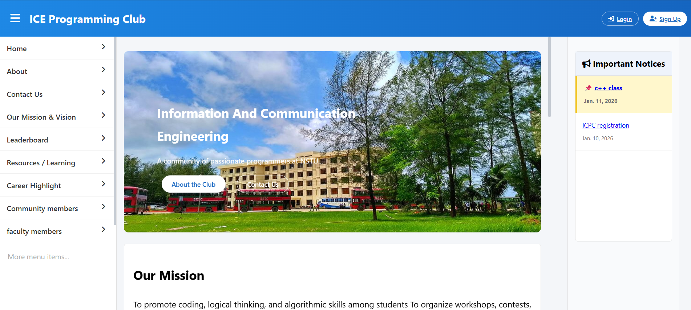
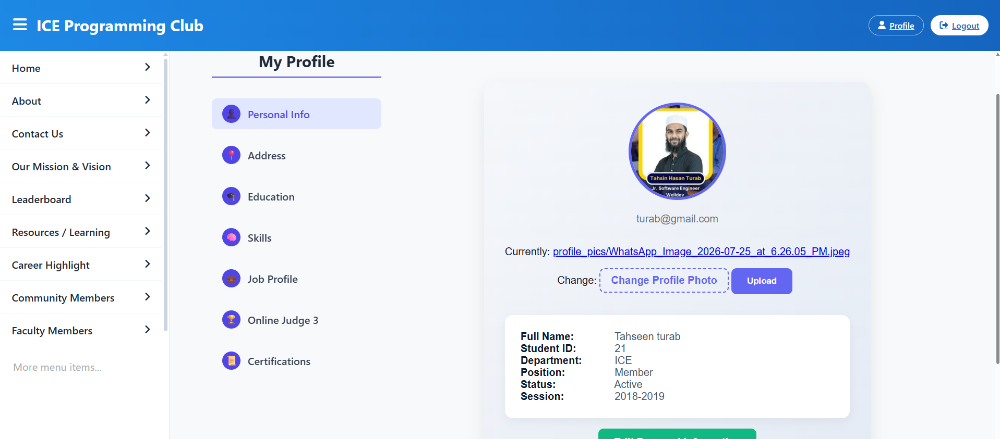
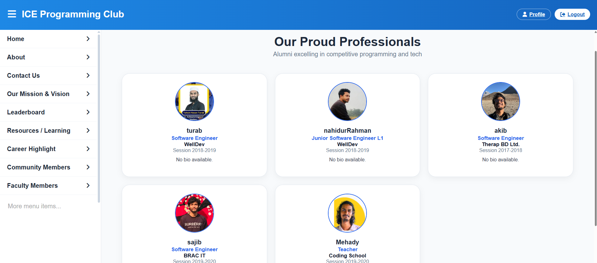
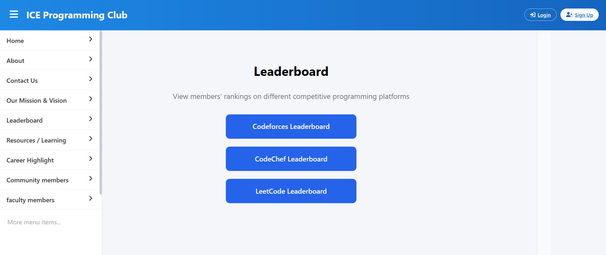
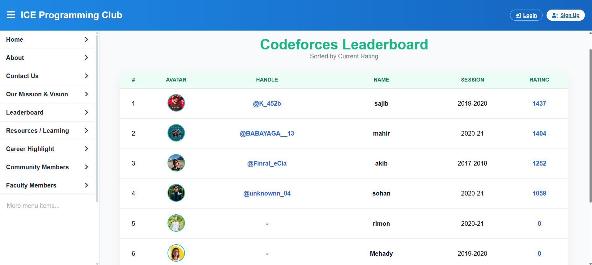
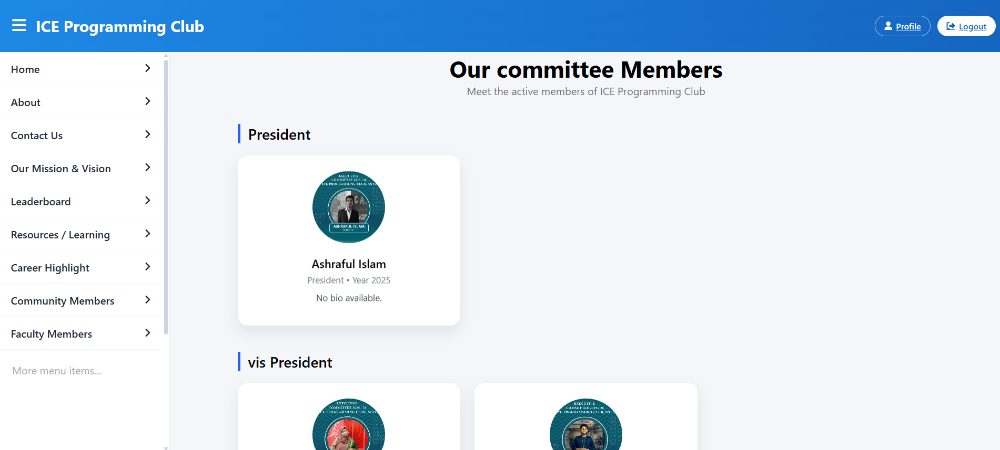
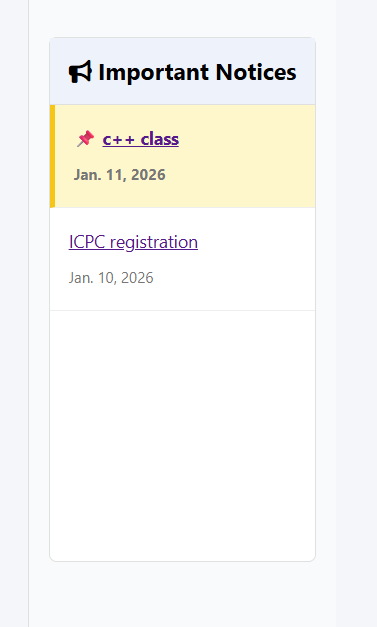
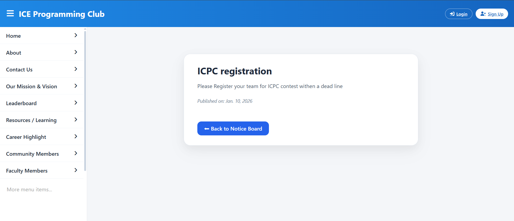
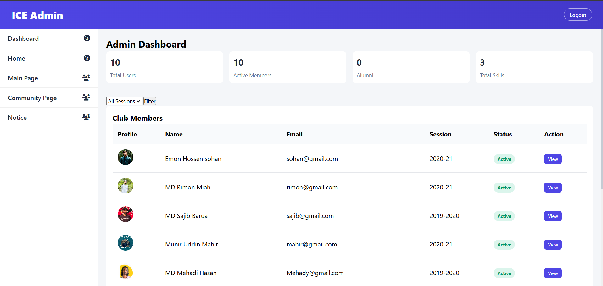

#  ICE Programming Club Website

A Django-based web application developed as an academic project to demonstrate the management of a university programming club. The platform includes member profiles, competitive programming statistics, career highlights of senior members, and club notice management.

---


##  Introduction

The ICE Programming Club Website is a web application developed as an academic project to simulate the management system of a university programming club. The platform provides features for managing member profiles, displaying competitive programming statistics, publishing club notices, and showcasing the career achievements of senior members.

The project integrates external APIs from Codeforces, CodeChef, and AtCoder to display live competitive programming ratings. It also includes a Career Highlights section that presents the professional profiles of senior members and alumni, allowing junior students to explore different career paths. Additionally, administrators can efficiently manage members, notices, and website content through the Django Admin Panel.


---

##  Key Features

-  Member profile management
-  Academic information display
-  Career Highlights of senior members and alumni
-  Professional job profile showcase
-  Live Codeforces rating integration
-  Live CodeChef rating integration
-  Live AtCoder rating integration
-  Club notices and announcements
-  Programming contest and event updates
-  Secure authentication system
-  Django Admin Panel


---

##  Career Highlights

The **Career Highlights** section showcases the professional achievements of senior members and alumni. It allows junior students to learn from their career journeys and explore different career opportunities.

The section includes:

- Current job position
- Company or organization
- Professional experience
- Academic background
- Career achievements
- Career guidance for junior students

---

##  Member Profiles

Each member has a dedicated profile containing:

- Personal information
- Academic details
- Batch information
- Skills
- Programming interests
- Social media links
- Competitive programming profiles

---

## Competitive Programming Integration

The platform retrieves competitive programming statistics using external APIs from:

- Codeforces
- CodeChef
- AtCoder

Displayed information includes:

- Current rating
- Highest rating
- Rank
- Username
- Programming profile links

---

##  Club Notices

A dedicated **Club Notices** section allows administrators to publish important information related to club activities.

The section includes:

- Important announcements
- Programming contest notices
- Workshop updates
- Seminar announcements
- Meeting schedules
- Event information
- General club updates

---

##  Technologies Used

### Backend

- Python
- Django


### Frontend

- HTML
- CSS
- JavaScript
- Bootstrap

### Database

- SQLite

### External APIs

- Codeforces API
- CodeChef API
- AtCoder API

### Version Control

- Git
- GitHub

---

##  Project Structure

```text
ICE-Programming-Club/
│
├── club/
├── members/
├── templates/
├── static/
├── media/
├── db.sqlite3
├── manage.py
├── requirements.txt
└── README.md
```

---

## Screenshots

###  Home Page



---

###  Member Profile



---

###  Career Highlights



---

###  Competitive Programming Statistics




---
### Our Committee Members



###  Club Notices





---

###  Django Admin Panel



---

##  Installation

### Clone the repository

```bash
git clone https://github.com/yourusername/ice-programming-club.git
```

### Navigate to the project directory

```bash
cd ice-programming-club
```

### Create a virtual environment

```bash
python -m venv venv
```

### Activate the virtual environment

**Windows**

```bash
venv\Scripts\activate
```

**Linux/macOS**

```bash
source venv/bin/activate
```

### Install dependencies

```bash
pip install -r requirements.txt
```

### Apply database migrations

```bash
python manage.py migrate
```

### Run the development server

```bash
python manage.py runserver
```

Open your browser and visit:

```
http://127.0.0.1:8000/
```

---


##  Future Improvements

- Alumni networking portal
- Online event registration
- Member achievement gallery
- Search and filtering functionality
- Email notification system
- Event calendar integration
- Blog section
- Placement statistics dashboard
- Create culb fund

---

##  Author

**Emon Hossen Sohan**

Department of Information and Communication Engineering (ICE)

Noakhali Science and Technology University (NSTU)

---

## 📄 License

This project was developed for educational and learning purposes as part of academic practice.